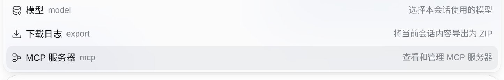

# MCP Servers

[English](README.md) | [简体中文](README.zh-CN.md)

Manage MCP servers in DSH with `/mcp`. View connection status and available tools, import configurations, and add, edit or remove local stdio and remote HTTP servers.



## Install

Add this plugin market index in DSH, then install **MCP Servers**:

```
https://p33333333333333l.github.io/dsh-mcp-servers/index.json
```

Or install directly through the plugin manager:

```
git+https://github.com/p33333333333333l/dsh-mcp-servers.git
```

Restart DSH or refresh the page after installation.

## Use

Enter `/mcp` in the conversation input and select **MCP Servers**, or press Enter. The panel follows your interface language (English or Chinese).

- Add or edit a server in the form, or delete it after confirmation.
- Import servers by pasting JSON or choosing a file, then reviewing the preview.
- Check the status dot beside each name: green means running, yellow means pending, red means failed, and gray means disabled or inactive. Hover for details.

Press `Esc` or enter `/mcp` again to close the panel.

## Server settings

Server names allow letters, numbers, underscores and hyphens, up to 32 characters. Tools appear to the model as `mcp__<server-name>__<tool-name>`.

| Connection | Settings |
| --- | --- |
| Local process (stdio) | Command such as `npx` or `/usr/bin/node`; one argument per line; optional working directory; environment variables as `KEY=VALUE`, one per line |
| Remote HTTP | Server URL such as `https://example.com/mcp`; optional headers as `NAME=VALUE`, one per line |

**Block startup when the connection fails** makes the MCP client fail to activate if it cannot connect.

Environment variables and headers can reference environment values with `!!js`:

```
Authorization=!!js "Bearer " + process.env.MCP_TOKEN
```

DSH evaluates the expression when loading the configuration. Existing expressions are preserved when edited. For multiline values, start each continuation line with a Tab; the panel adds this marker when displaying existing values.

## Import

Accepts a `mcpServers` object or a plain object keyed by server name:

```json
{
  "mcpServers": {
    "local": { "command": "npx", "args": ["-y", "example-mcp"] },
    "remote": { "type": "http", "url": "https://example.com/mcp" }
  }
}
```

Local servers support `command`, `args`, `env` and `cwd`. Remote servers support `url` and `headers`; `type` may be omitted or set to `"http"` or `"streamable-http"`.

Duplicate names, invalid data or unsupported fields (including SSE and `disabled`) reject the whole batch without overwriting existing servers. Failed writes or reloads roll back the batch.

Imported environment variables and headers stay literal strings, including unchanged `!!js` text on later edits. The reserved dictionary key `__jsExpr` is not accepted.

## Configuration changes and limits

- The panel manages the current DSH profile. Install the plugin separately in each profile you use.
- Changes update that profile's `cordis.patch.yml`. Back up `~/.dsh/profiles/<profile>/cordis.patch.yml` before first use.
- Saving reconnects the MCP client and may interrupt active tool calls. Deleting a server removes all its tools.
- Servers defined as top-level overrides rather than in an `insert` list can be viewed, but must be removed manually.
- The panel uses your authenticated DSH session. Set `manage: false` in the plugin configuration for read-only access:

```yaml
- insert:
    - id: mcp-manager
      name: 'dsh-mcp-servers'
      config:
        manage: false
```

## License

[Apache License 2.0](LICENSE)
