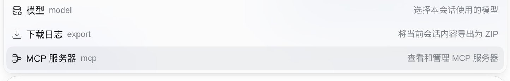

# dsh-mcp-servers

[English](README.md) | [简体中文](README.zh-CN.md)

在 DSH 中通过 `/mcp` 管理 MCP 服务器：查看插件状态和可用工具，导入配置，添加、编辑或删除本地 stdio 与远程 HTTP 服务器。



## 安装

在 DSH 中添加以下插件市场索引，再安装「MCP 服务器」：

```
https://raw.githubusercontent.com/p33333333333333l/dsh-mcp-servers/refs/heads/main/index.json
```

也可以通过插件管理器直接安装：

```
git+https://github.com/p33333333333333l/dsh-mcp-servers.git
```

安装后重启 DSH 或刷新页面。

## 使用

在对话输入框输入 `/mcp`，选择「MCP 服务器」或直接回车。面板语言跟随界面设置，支持中文和英文。

- 添加或编辑服务器时填写表单。创建后服务器名不可修改，删除前需确认。
- 粘贴 JSON 或选择文件，然后点击「导入」。
- 绿色表示 MCP 客户端插件已加载，黄色表示等待中，红色表示加载失败，灰色表示已停用或未运行。工具列表显示当前已注册的工具。

按 `Esc` 或再次输入 `/mcp` 关闭面板。

## 服务器设置

服务器名只能使用字母、数字、下划线和连字符，最长 32 字符。工具在模型侧显示为 `mcp__<服务器名>__<工具名>`。

| 连接方式 | 填写内容 |
| --- | --- |
| 本地进程（stdio） | 命令，如 `npx` 或 `/usr/bin/node`；参数每行一个；工作目录可选；环境变量每行 `KEY=VALUE` |
| 远程 HTTP | 服务地址，如 `https://example.com/mcp`；请求头可选，每行 `NAME=VALUE` |

勾选「连接失败时阻止启动」后，无法连接会导致 MCP 客户端激活失败。

环境变量和请求头可以用 `!!js` 引用环境中的值：

```
Authorization=!!js "Bearer " + process.env.MCP_TOKEN
```

DSH 在加载配置时求值，已有表达式在编辑时保留。多行值的续行以一个 Tab 开头；面板显示已有值时会自动添加这个标记。

## 导入

支持 `mcpServers` 对象，也支持直接以服务器名为键的对象：

```json
{
  "mcpServers": {
    "local": { "command": "npx", "args": ["-y", "example-mcp"] },
    "remote": { "type": "http", "url": "https://example.com/mcp" }
  }
}
```

本地服务器支持 `command`、`args`、`env`、`cwd`。远程服务器支持 `url`、`headers`；`type` 可省略，也可设为 `"http"` 或 `"streamable-http"`。

遇到重名、格式错误或不支持的字段（包括 SSE、`disabled`）时，整批不写入，也不会覆盖已有服务器。导入面板会保留输入，可按提示修改后重试。写入或重载失败会整批回滚。

导入的环境变量和请求头保留为普通字符串，包括后续编辑时未修改的 `!!js` 文本。字典中的保留键 `__jsExpr` 不支持导入。

## 配置变更与限制

- 面板只管理当前 DSH profile；其他 profile 需分别安装。
- 改动写入该 profile 的 `cordis.patch.yml`。首次使用前，请备份 `~/.dsh/profiles/<profile>/cordis.patch.yml`。
- 保存会重连 MCP 客户端，可能中断正在进行的工具调用。删除服务器会移除它提供的全部工具。
- 面板可以删除在当前 profile 补丁中有唯一插入条目的服务器。其他服务器需在定义它的位置删除。
- 打开表单后若配置已被其他操作修改，请重新打开面板再保存。若补丁文件是符号链接，或含有宿主编辑器会改写的 `__jsExpr` 字面量映射，请直接编辑配置文件。
- 面板使用已认证的 DSH 会话。需要只读模式时，在插件配置中设置 `manage: false`：

```yaml
- insert:
    - id: mcp-manager
      name: 'dsh-mcp-servers'
      config:
        manage: false
```

## 开发目录

| 位置 | 用途 |
| --- | --- |
| [`host/`](host/) | 宿主端管理接口、配置文档编辑及 profile 写入与重载。 |
| [`client/`](client/) | 浏览器中的 `/mcp` 面板及交互。 |
| [`locale/`](locale/) | 中文、英文界面文案。 |
| [`assets/`](assets/) | 插件市场图标与展示截图。 |
| [`test/`](test/) | 导入、配置文档编辑及前后端约定的回归检查。 |

根目录的 `package.json`、`cordis.patch.yml`、`index.json`、`screenshots.json` 和 `icon.svg` 是包、插件或市场使用的入口与元数据，保留在原位。测试命令为 `npm test`。

## 协议

[Apache License 2.0](LICENSE)
